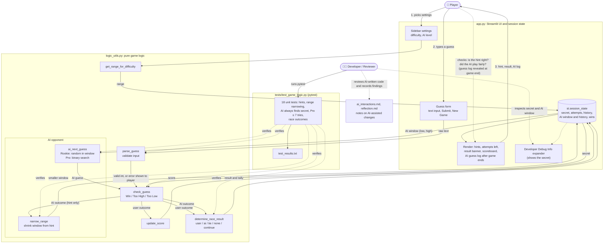

# System Diagram: Game Glitch Investigator (Race the AI)

## Reading the diagram

- **Solid arrows** are the data flow for one round: the player's guess is parsed, checked against the secret, and scored. Right after it, the AI picks its own guess, gets only the Higher/Lower hint, and narrows its search window. Both outcomes go to `determine_race_result`, and the state is rendered back to the player.
- **Dotted arrows** are the human and testing checkpoints:
  - The **player** sees the hints and, once the game ends, the AI's full guess log, so they can check that the AI played fairly.
  - The **developer** uses the Debug expander to inspect the secret and AI state, runs **pytest** against the logic functions (including the AI and race rules), and reviews AI-written code, recording the findings in the notes files.
- All game rules live in `logic_utils.py` with no Streamlit dependency, which is what makes them testable. `app.py` only wires the UI to those functions and holds session state.
